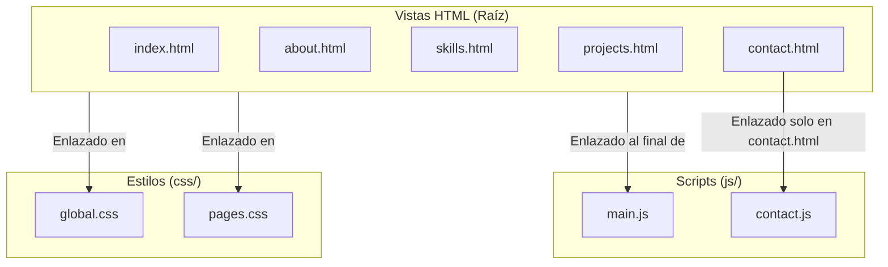

# Proyecto de Clase: Portafolio Web Personal (HTML, CSS y JS Puro)

Este documento define la **arquitectura oficial, reglas técnicas y guía de construcción** del proyecto de Portafolio Web Personal.

---

## 1. Objetivo del Proyecto
Desarrollar un sitio web personal de **5 páginas independientes** que compartan una misma identidad visual (encabezado, menú de navegación, paleta de colores, tipografía y pie de página), utilizando únicamente tecnologías web nativas.

---

## 2. Reglas Técnicas Estrictas (Restricciones)
Tanto el estudiante como cualquier Agente de IA que asista en el código deben cumplir estas reglas:
1. **Solo tecnologías nativas**: Únicamente **HTML5**, **CSS3** y **JavaScript puro (Vanilla JS)**.
2. **Sin frameworks ni librerías**: No usar Bootstrap, Tailwind, React, Vue, jQuery ni plantillas externas.
3. **Sin backend**: Toda la funcionalidad debe ejecutarse en el navegador del cliente.
4. **Sitio Multipágina (MPA)**: Cada sección principal debe ser un archivo `.html` independiente (no construir todo en una sola página de scroll largo).
5. **Convención de idioma**:
   * **Nombres de archivos, carpetas, IDs y clases CSS**: en **inglés** (`index.html`, `about.html`, `.nav-menu`, `.project-card`).
   * **Contenido visible para el visitante y comentarios del código**: en **español**.

---

## 3. Arquitectura Oficial de Carpetas y Archivos
El proyecto debe respetar exactamente la siguiente estructura:
```text
portfolio-web/
│
├── README.md               # Especificación y guía del proyecto
├── index.html              # Página 1: Inicio (Presentación y resumen)
├── about.html              # Página 2: Sobre mí (Biografía, trayectoria y CV)
├── skills.html             # Página 3: Habilidades (Técnicas, herramientas y blandas)
├── projects.html           # Página 4: Proyectos (Galería de tarjetas de proyectos)
├── contact.html            # Página 5: Contacto (WhatsApp, LinkedIn, Correo y formulario)
│
├── css/
│   ├── global.css          # Variables (:root), reset, botones, header, nav y footer
│   └── pages.css           # Estilos específicos del contenido (<main>) de cada página
│
├── js/
│   ├── main.js             # Lógica global (menú móvil, enlace activo y año del footer)
│   └── contact.js          # Lógica de contacto (copiar correo, validar form, enviar a WhatsApp/mailto)
│
└── assets/
    ├── img/                # Foto de perfil e imágenes de proyectos
    └── docs/               # Currículum Vitae en PDF para descarga
```

---

## 4. Responsabilidad y Relación entre Archivos



### A. Estructura Compartida en los 5 Archivos HTML
Todos los archivos `.html` tienen **exactamente el mismo bloque `<header>` y `<footer>`**, cambiando únicamente el contenido dentro de `<main>`:
* **`<head>`**: Enlaza siempre `css/global.css` primero y `css/pages.css` después.
* **`<header class="site-header">`**: Contiene `<nav class="navbar container">` con:
  * El logo (`<a href="index.html" class="logo">`).
  * El botón de menú móvil (`<button class="menu-toggle" id="menu-toggle">`).
  * La lista de navegación (`<ul class="nav-menu" id="nav-menu">`) con enlaces a `index.html`, `about.html`, `skills.html`, `projects.html` y `contact.html`.
* **`<main>`**: Contenido propio de cada página.
* **`<footer class="site-footer">`**: Derechos de autor con `<span id="current-year"></span>` y enlaces rápidos a redes.

---

### B. Especificación de Cada Vista HTML
1. **`index.html` (Inicio)**: Hero con saludo, botones de acción e imagen; sección de 3 tarjetas de fortalezas (`.highlights-grid`).
2. **`about.html` (Sobre mí)**: Cuadrícula de 2 columnas (`.about-grid`) con biografía personal, botón de descarga de CV y línea de tiempo (`.timeline-list`).
3. **`skills.html` (Habilidades)**: Cuadrícula (`.skills-grid`) por categorías (Frontend, Herramientas, Habilidades Blandas) con barras de progreso (`.progress-bar`).
4. **`projects.html` (Proyectos)**: Galería de proyectos (`.projects-grid`) con imagen, badges de tecnologías y botones a Demo y Código.
5. **`contact.html` (Contacto)**: Canales directos (WhatsApp, LinkedIn, Correo con botón para copiar) y formulario con opciones de envío por Correo y WhatsApp.
